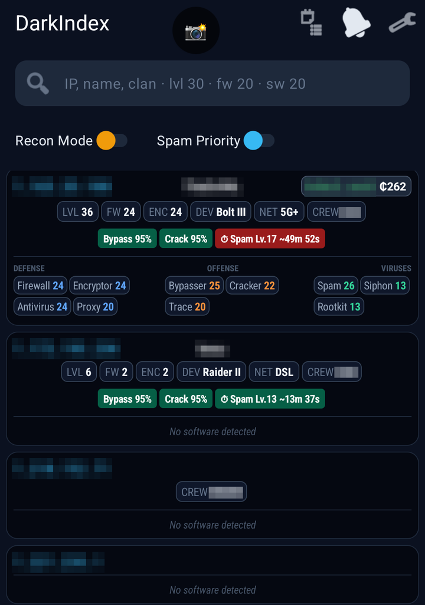
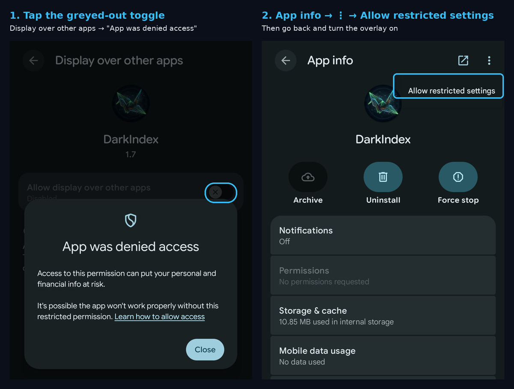

# DarkIndex

Vibe-coded to the moon and back, just like the game.

**DarkIndex** is an open-source companion and organization tool for the mobile game **HackEx 2**. It allows players to track, search, validate, and export virtual in-game target intelligence (such as IP addresses, player names, software levels, and in-game crypto wallet addresses) gathered during gameplay.

> **Want to test out the functionality first?** Check out the web version: [DarkIndexWeb](https://github.com/whisk420/DarkIndexWeb).

<p align="center"></p>

Each card fills in as you scrape. From the bottom up: a bare IP (seen in a log or process list), a crew tag (from a crew roster), level and hardware with hack odds and a Spam upload time (from the target's Home screen), and a full card with the wallet and its income, plus every app's level (from the Wallet and Software screens). The last part of each IP is blurred.

---

## Features

- **On-Demand Game Screen Scraper**: Captures visible text from the HackEx game interface when manually triggered via a floating quick-action overlay button.
- **In-Game Overlay Toolbar**: Floating camera button and advanced targeting/validation controls overlay the game window for fast target clipboard copying and status tracking.
- **Local On-Device Database**: Keeps target intelligence on the device in a private JSON file, saved in the background so scraping stays fast even with thousands of targets.
- **Regex Game Text Parser**: Extracts target profiles, software inventories, wallets, activity logs, crew rosters, processes and scan results using pattern matching tailored to HackEx UI text layouts.
- **Passive Wallet Income Estimator**: Groups the thefts in your own log into sessions (split wherever more than an hour passes) and works out each target wallet's hourly crypto rate.
- **Hack Odds & Upload Times**: Each target card shows your bypass and crack success chances and how long a virus upload will take, based on your own hardware and software from the Store.
- **Good Spam Ranking**: Ranks targets you can bypass by how much Spam would earn there and how fast it uploads, and recommends the cheapest Spam level that still hits the 100/hr cap.
- **Siphon Alerts**: Warns you when a siphon disappears from your earnings list, usually because the victim ran Antivirus.
- **Marathon Mode**: A timed stealing run (5, 10 or 20 minutes) that reads your log at the end and ranks every wallet by income.
- **Knowledge Base**: In-app game reference with formulas, tables and calculators, each fact labelled by where it comes from (measured, calculated, guide…).
- **Advanced Targeting Mode**: Optional dashboard mode that filters your list to only show targets lacking critical scraping information, paired with a specialized overlay toolbar to cycle through incomplete targets and skip time-consuming bypasses.
- **Search & Filtering**: Filter by IP, username, wallet, clan, hardware or app name, or use shortcuts: `lvl 30` / `lvl 28-32` for player level, `sw 20` for targets with the most apps at exactly Lv20, `spam 17` or `fw 20` for one app's level.
- **Smart SAF Import & Export**: Instantly export your target database or import target bundles with Android's Storage Access Framework seamlessly linked to your `Downloads/DarkIndex/` folder.
- **Raw Dump Mode** (debug): Records exactly what each scrape saw and how it was understood, for troubleshooting a screen the app gets wrong.

---

## How to Install (Sideloading)

Because DarkIndex is not distributed via the Google Play Store and utilizes Android's Accessibility Services for screen scraping, you must manually install it (sideload) and explicitly grant it permissions.

1. **Download the APK**: Navigate to the Releases page on GitHub and download the latest `.apk` file to your Android device.
2. **Enable "Install Unknown Apps"**: Tap the downloaded APK to open it. If your phone prompts you that your browser/file manager is not allowed to install unknown apps, tap **Settings** and toggle **"Allow from this source"**.
3. **Bypass Play Protect Warning**: Google Play Protect may show an "Unsafe app blocked" warning because the developer is unknown. Tap **More details** (or the small arrow) and select **Install anyway**.
4. **Allow Restricted Settings (Crucial for Android 13+)**: Android blocks sideloaded apps from the overlay and accessibility permissions, and the menu that unblocks them **stays hidden until Android has blocked you once**:
   - Open DarkIndex and tap **Grant Overlay**. The **Allow display over other apps** toggle is greyed out. **Tap it anyway**: Android shows **"App was denied access"**. Tap **Close**.
   - Now go to **Settings** -> **Apps** -> **DarkIndex**, tap the **3 vertical dots (⋮)** in the top-right corner, then **Allow restricted settings**, and confirm with your PIN or fingerprint.
   - Go back and turn on the overlay toggle. It works now.
   - *(Until you've tapped the greyed-out toggle once, the ⋮ menu doesn't offer Allow restricted settings.)*

   <p align="center"></p>

5. **Finish in DarkIndex**: Launch the app again and follow the prompts to turn on **Accessibility**. The unlock from step 4 covers it too.
6. **Manually Enable Accessibility (If needed)**: If the app does not automatically take you to the correct Accessibility menu, or if the camera icon fails to appear after granting permissions, you can manually enable it by going to your phone's **Settings** -> **Accessibility** -> **Downloaded Apps** (or **Installed Services**) -> **DarkIndex** and toggling it **ON**.

---

## How to Build Yourself

If you are a developer, security-conscious, or simply want to tinker with the code, you can easily build the app from source. No keys, accounts or special setup are needed.

1. **Prerequisites**: Ensure you have [Android Studio](https://developer.android.com/studio) and Git installed on your computer.
2. **Clone the Repository** (or your fork):
   ```bash
   git clone https://github.com/whisk420/DarkIndex.git
   ```
3. **Open the Project**: Launch Android Studio, select **Open**, and select the project directory.
4. **Sync Gradle**: Let Android Studio automatically download the required Gradle dependencies (and the JDK toolchain) and sync the project structure.
5. **Build and Install**:
   - **Run on a device or emulator**: press **Run ▶** in Android Studio.
   - **Build APK**: `./gradlew assembleDebug` (Windows: `gradlew.bat assembleDebug`)
   - **Run the unit tests**: `./gradlew testDebugUnitTest`

> **Signing (you can ignore this):** your builds are signed with your own Android Studio debug key. That's expected. The project's release key is only used for official GitHub releases. Gradle prints a one-line warning about the missing key; it's harmless.
>
> **⚠️ Already have the official DarkIndex installed on the same phone?** Android won't install a build signed with a different key over it and will ask you to uninstall it first, which deletes its data. Use **⋮ → Export Data** beforehand (and **Import Data** afterwards), or test on an emulator or second device.

### Contributing

Pull requests are welcome.

1. Fork the repo and create a branch.
2. Make your change, then run `./gradlew testDebugUnitTest`. All tests must pass.
3. **Parser changes need a test.** Save the real screen text as a `.txt` file in `app/src/test/resources/fixtures/` and load it with `TestEnv.fixture("name.txt")` (see `RealDataRegressionTest`). Start each test with `TestEnv.freshRepository()` so it runs on an empty, isolated database.
4. **Getting real screen text:** enable **Settings & Account → Debug → Raw Dump Mode**. Every 📼 scrape is saved under the Raw Dumps icon, with the raw text, what each parser understood, discarded log lines and database changes. Tap a card to copy its JSON for a test fixture, an issue or your PR.
5. Open a PR describing which game screens it affects. GitHub runs the unit tests on every push and PR automatically.

Never commit signing keys (`*.jks`, `keystore.properties`) or database exports (`*.json`). `.gitignore` already excludes them.

---

## System Permissions Explained

DarkIndex requires specific Android permissions to provide overlay controls and read in-game screen text:

| Permission | Purpose |
| :--- | :--- |
| `SYSTEM_ALERT_WINDOW` ("Display over other apps") | Renders the floating quick-action overlay camera button and validation toolbar over the HackEx game window. |
| `FOREGROUND_SERVICE` | Keeps the floating overlay service active during gameplay sessions. |
| `FOREGROUND_SERVICE_SPECIAL_USE` | The foreground-service type Android 14+ requires for an overlay like this one. |
| `BIND_ACCESSIBILITY_SERVICE` | Used strictly as an **on-demand UI screen reader** to read visible text node elements on screen when the user manually taps the floating overlay button while playing HackEx. |
| `VIBRATE` | One short buzz when a Marathon Mode timer runs out. |

---

## Architecture Overview

```text
com.whisk.hackexlogger
 ├── MainActivity                   # Dashboard: target list, search, Good Spam / Recon modes, backup & restore.
 ├── ScraperAccessibilityService    # Accessibility Service that reads active window text nodes upon user trigger.
 ├── OverlayService                 # Foreground Service presenting floating UI widgets over the game interface.
 ├── ScrapePipeline                 # One scrape: recognise the screen, parse it, save what it found.
 ├── ScreenParsers                  # Regex parsers mapping HackEx game UI text to structured data.
 ├── DatabaseManager                # Turns each parsed screen into database changes.
 ├── TargetRepository               # The in-memory database and its background saving.
 ├── TargetStore                    # The database file (targets.json): tolerant loading, atomic writes.
 ├── RecordMerger                   # Rules for merging records that describe the same player.
 ├── DatabaseBackup                 # Export / import and the Downloads auto-backup format.
 ├── DatabaseMaintenance            # Database clean-up and the 30-day theft purge.
 ├── SiphonTracker                  # Tracks deployed siphons to alert you when one is wiped.
 ├── GameFormulas & HardwareCatalog # Game maths (prices, odds, Spam income) and device/network names.
 ├── Marathon                       # Marathon Mode engine.
 ├── KnowledgeBase                  # In-app game reference and calculators.
 ├── RawDump                        # Raw Dump Mode recording and storage.
 ├── TargetAdapter                  # RecyclerView adapter for rendering target cards and headers.
 └── TargetRecord & ConsoleBundle   # Data models and the JSON export/import format.
```

---

## How It Works

1. **Enable Permissions**: Launch DarkIndex and ensure the overlay and accessibility permissions are enabled (either via the popup prompt or manually in Settings).
2. **Open HackEx**: Launch the HackEx game app. A small floating camera button will appear on your screen.
3. **Capture Data**: Navigate to a target's profile, software page, wallet screen, or log screen in HackEx, and tap the floating camera button.
4. **View & Search**: Return to DarkIndex to view parsed target stats, search software levels, or export your target database as a JSON bundle.

---

## Privacy & Storage

Your data is **100% under your exclusive control and 100% offline**.

- **No Internet Permission:** DarkIndex excludes internet permissions completely. Zero network calls or cloud connections are made.
- **Durable Storage:** A full backup is automatically kept in your phone's public `Downloads/DarkIndex/` folder (refreshed about 30 seconds after you scrape, and whenever you leave the app). Files stored here persist through app uninstalls and data wipes.
- **Smart Import/Export:** Import and export file pickers launch directly inside `Downloads/DarkIndex/` for instant one-tap backup management.

---

## License

Public domain: see [UNLICENSE](UNLICENSE). Do whatever you want with it.
